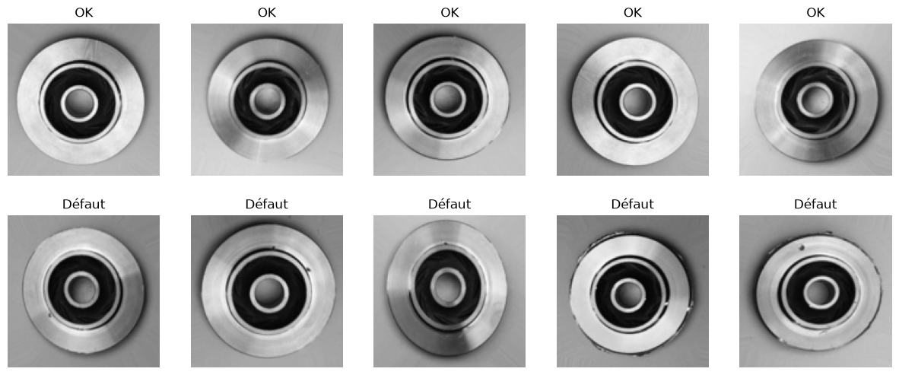
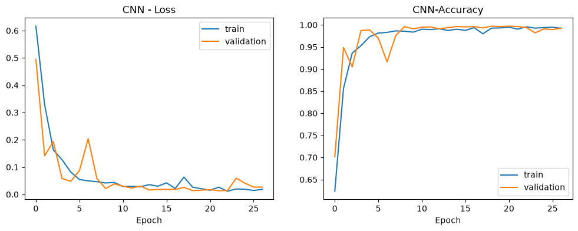
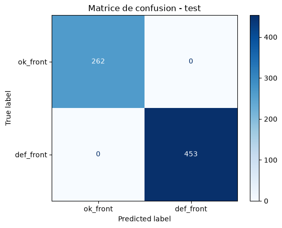

# ✈️ AeroTech — Classification de défauts sur pièces mécaniques

<p align="center">
  
</p>

<p align="center">
  
  
  
  
  
  
</p>

<br/>

> 🎓 Projet réalisé dans le cadre de la **formation IA de DigitalCity**.

La société fictive **AeroTech Solutions** inspecte visuellement les pièces mécaniques des avions après chaque vol. Aujourd'hui, ce contrôle est fait à la main par des techniciens, ce qui ralentit la maintenance.

L'objectif : un **modèle de Deep Learning** capable de dire automatiquement, à partir d'une photo, si une pièce est **conforme** ou **défectueuse**.

---

## 📸 Le dataset

**Casting Product Image Data for Quality Inspection** (Kaggle) : **7 348 images** de pièces métalliques moulées, vues de dessus, réparties en deux classes.

| Classe | Signification | Train | Test |
|---|---|---|---|
| `ok_front` | Pièce conforme | 2 875 | 262 |
| `def_front` | Pièce défectueuse | 3 758 | 453 |

<p align="center">
  
</p>

---

## 🧠 Démarche

1. **Exploration** : volume, répartition des classes, résolution des images (300×300, redimensionnées en 128×128).
2. **Découpage** : le test d'origine reste intact, 20 % du train sert de validation (découpage stratifié).
3. **Baselines** : un `DummyClassifier` puis une **régression logistique** sur les pixels, pour avoir un score de référence.
4. **CNN personnalisé** : 3 blocs Conv2D + MaxPooling, Dropout et EarlyStopping.
5. **Data Augmentation** : flip, rotation, zoom, contraste, comparée au CNN simple.
6. **Évaluation finale** sur le jeu de test, analyse des **faux négatifs** et réglage du **seuil de décision**.

<p align="center">
  
</p>

---

## 📊 Résultats

| Modèle | Accuracy validation |
|---|---|
| Dummy (classe majoritaire) | 0,567 |
| Régression logistique | 0,902 |
| CNN + augmentation | 0,992 |
| **CNN simple (retenu)** | **0,996** |

Sur le **jeu de test** (715 images jamais vues), le CNN retenu obtient **100 %** en accuracy, precision, recall et F1, sans aucune erreur.

<p align="center">
  
</p>

### Pourquoi le recall compte plus que l'accuracy

En aéronautique, laisser passer une pièce fissurée (**faux négatif**) est bien plus grave que faire revérifier une pièce saine (**faux positif**). Sur la validation, le modèle rate encore 4 défauts sur 1 327 images : des défauts minuscules qui ne font plus que quelques pixels en 128×128.

Baisser le seuil de 0,5 à **0,1** fait passer les faux négatifs de 4 à 2, pour 7 faux positifs au lieu de 1 : un bon compromis dans ce contexte.

### Pistes d'amélioration

- Une **résolution plus grande** (256×256 ou 300×300) pour garder les petits défauts visibles
- Un modèle pré-entraîné (**Transfer Learning**)
- Une **vérification humaine** pour les prédictions incertaines (probabilité entre 0,1 et 0,9)

---

## 🚀 Lancer le projet

```bash
git clone https://github.com/Aeyis/aerotech-defect-classifier.git
cd aerotech-defect-classifier

python -m venv .venv
# Windows : .\.venv\Scripts\Activate.ps1
# macOS / Linux : source .venv/bin/activate

pip install -r requirements.txt
```

Le dataset n'est pas inclus dans le repo (environ 120 Mo). Téléchargez-le sur
[Kaggle](https://www.kaggle.com/datasets/ravirajsinh45/real-life-industrial-dataset-of-casting-product)
et décompressez-le à la racine du projet :

```
aerotech-defect-classifier/
├── product_image/
│   └── casting_data/
│       └── casting_data/
│           ├── train/
│           │   ├── def_front/
│           │   └── ok_front/
│           └── test/
│               ├── def_front/
│               └── ok_front/
└── aerotech_defect_classifier.ipynb
```

Ouvrez ensuite `aerotech_defect_classifier.ipynb` dans Jupyter ou VS Code.

---

## 👤 Auteur

**Rafael Solis Ramos** — [GitHub](https://github.com/Aeyis) · [LinkedIn](https://www.linkedin.com/in/rafael-solis-ramos) · [myfaro.dev](https://myfaro.dev)
